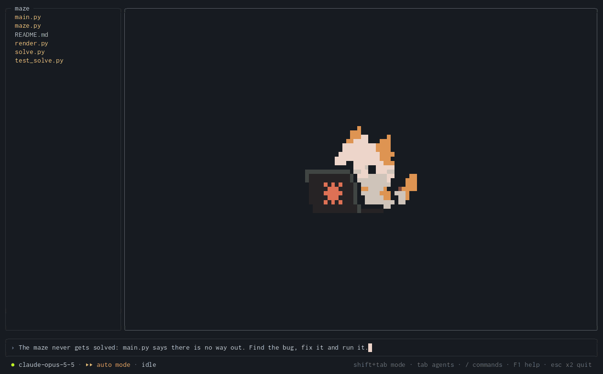

# ClaudIt

ClaudIt is a terminal UI around [Claude Code](https://github.com/anthropics/claude-code). You talk to
claude as usual, and above the conversation every agent — the main one and its helpers — visibly works
in its own editor and terminal.



## Install

You need Claude Code installed as `claude` and logged in, and Go 1.26 or newer.

```sh
go install github.com/pixelbender/claudit@latest    # puts claudit in $(go env GOPATH)/bin
```

## Run

In your project:

```sh
claudit
```

Arguments go on to claude, so `claudit --model haiku` works too.

The rest you'll figure out.
